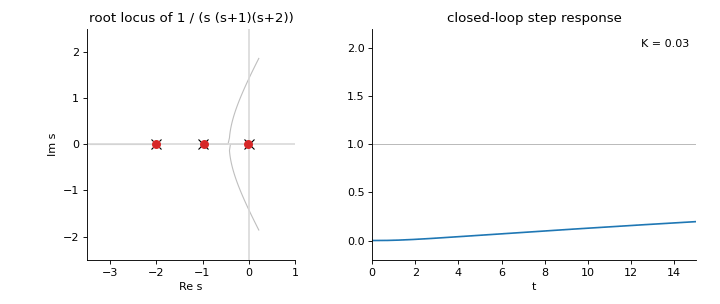
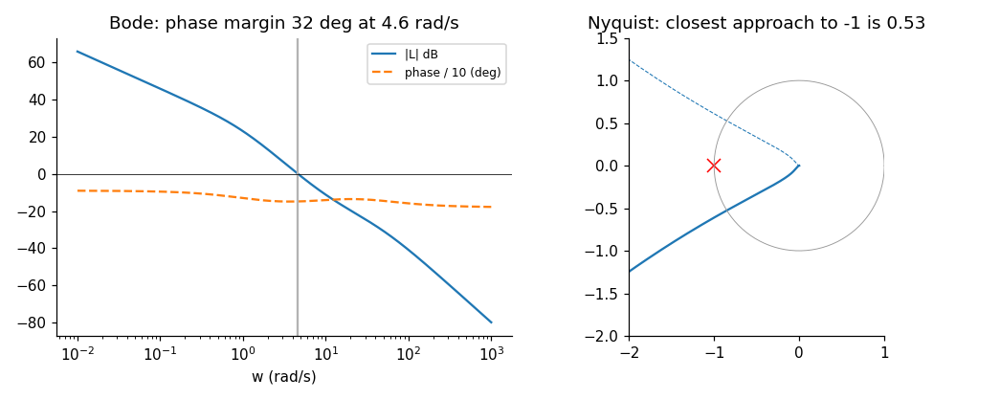
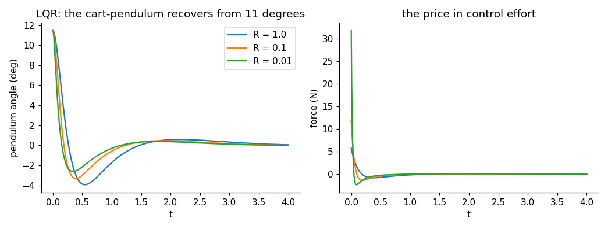
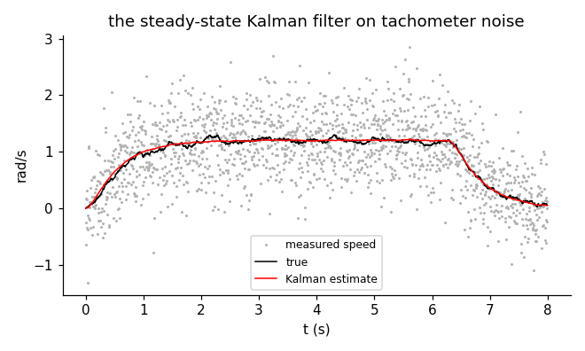
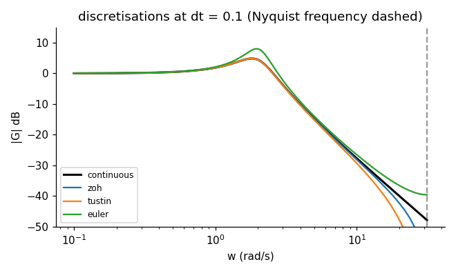
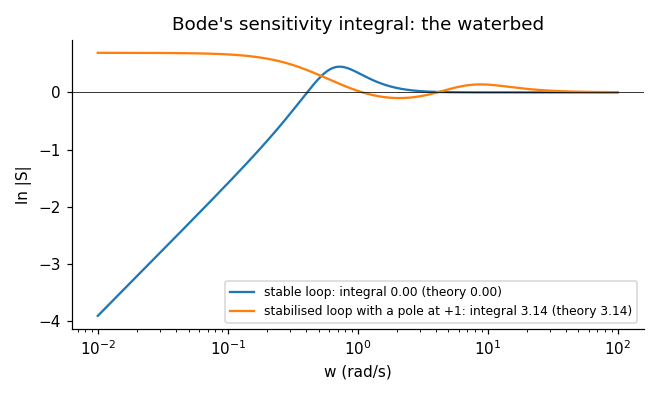
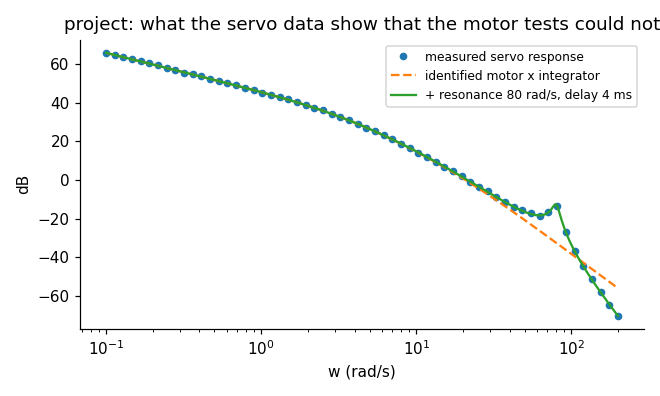

<div align="center">

# englincontrol

**Linear control theory from scratch: a validated NumPy toolkit, ten example plants with course data, and a 20-notebook course with worked solutions.**

[](https://github.com/ktwyw/englincontrol/actions/workflows/tests.yml)
[](docs/VALIDATION.md)
[](notebooks)
[](pyproject.toml)
[](LICENSE)
[](https://orcid.org/0000-0002-8488-9833)



</div>

`englincontrol` implements linear control theory in plain NumPy and teaches it through computation. State-space
and transfer-function models and their conversions; exact time responses by the matrix exponential; Bode,
Nyquist and Nichols plots with gain, phase and delay margins; Routh-Hurwitz, Jury, Lyapunov, the root locus
with its rules and the Nyquist criterion as a computation; PID with tuning rules, relay autotuning,
anti-windup and the derivative kick; lead/lag design and loop shaping; controllability, observability, pole
placement, observers and the separation principle; LQR, the Kalman filter and LQG with the robustness problem
Doyle found; sampling, discretisation and digital design; the gang of four, Bode's sensitivity integral, the
limits set by right-half-plane zeros, unstable poles and delays, disk margins and the small-gain theorem;
identification by step, frequency-response, ARX, instrumental-variable and output-error methods; balanced
truncation and the eigensystem realisation algorithm; MIMO basics with singular values, transmission zeros
and the relative gain array; and the numerics underneath (Padé exponentials, Schur-based Lyapunov,
Hamiltonian Riccati solvers, H∞ by bisection). The core depends on NumPy only; SciPy and python-control are
used to check it.

```python
import numpy as np
from englincontrol import systems as sy, response as rs, frequency as fr, statespace as sp, models

G = sy.tf([10.0], [1.0, 3.0, 2.0, 0.0])           # 10 / (s (s+1)(s+2))
fr.margins(G)["gain_margin"]                       # 0.6: too much gain, the loop is unstable
t, y = rs.step(sy.feedback(sy.tf([2.0], G.den)))   # exact step response at K = 2

cp = models.cart_pendulum()["system"]              # an unstable 4-state plant with physical parameters
K = sp.lqr(cp.A, cp.B, np.diag([10, 1, 100, 1]), [[0.1]])["K"]
L = sp.observer_gain(cp.A, cp.C, [-10, -11, -12, -13])
sp.closed_loop_with_observer(cp, K, L).poles()     # the regulator and observer poles together: separation
```

## Why englincontrol?

- **Every method validated, every claim checked.** 204 checks in [`docs/VALIDATION.md`](docs/VALIDATION.md),
  rerun in CI with warnings as errors: closed forms (second-order step formulas, Routh on polynomials with
  known roots, the Riccati solution's optimal cost against a Lyapunov integral, Bode's integral equal to π per
  unstable pole), SciPy and LAPACK (expm, Schur, Lyapunov, CARE/DARE, discretisation, pole placement),
  python-control (margins, LQR, Kalman gains, root loci, transmission zeros), and the theory itself
  (RK4's 2.785, Kalman's return-difference inequality, the describing-function accuracy of a relay experiment).
- **The numerics are the subject, not hidden.** Scaling-and-squaring Padé for the matrix exponential (and
  why Taylor fails), Bartels-Stewart on a hand-written real Schur form, the Hamiltonian's stable subspace with
  Newton-Kleinman refinement, the doubling algorithm for the discrete Riccati equation, and the conditioning
  of polynomial coefficients, companion forms and *computed* balanced realisations - with the surprises the
  computations produced left in.
- **Design decisions made on data.** The course's plants carry physical parameters and known properties; the
  identification chapter and the project work from measurements with noise, a dropped sample, an unmodelled
  resonance and a delay, and the project's conclusion (that the observer should be *slow*) came from the
  robustness check, against the textbook rule.
- **Failures taught, not avoided.** Windup, the derivative kick, hidden unstable modes, a lead design that
  cannot supply the phase, an LQG loop with no margins, ARX bias from output noise at fast sampling, a
  decoupler that turns a loop into positive feedback, a balanced realisation worse than the companion form it
  came from.

## What's inside

| Module | Contents |
|---|---|
| `systems` | `StateSpace` and `TransferFunction` (continuous or discrete); exact conversions (canonical realisations, Leverrier-Faddeev); modal, balanced and minimal realisations; series, parallel, feedback; `zpk` |
| `polynomials` | polynomial algebra, Horner evaluation, companion-matrix roots |
| `linalg` | Padé expm, ZOH matrices, real Schur form (shifted QR), Lyapunov/Sylvester, CARE (Hamiltonian + Newton), DARE (doubling), Gramians |
| `response` | exact time responses, step/impulse/initial, step characteristics, second-order formulas, dominant poles |
| `frequency` | G(jω), Bode/Nyquist/Nichols, all gain and phase crossovers, delay margin, bandwidth, resonant peak, Padé delays, H∞ norm by bisection |
| `stability` | Routh with both special cases, Hurwitz, Jury, Lyapunov test, root locus with asymptotes/breakaway/departure angles, the Nyquist criterion with indentation |
| `design` | PID forms, ZN/Cohen-Coon/SIMC rules, relay autotuning, PID simulation with saturation and anti-windup, lead/lag design, feedforward |
| `statespace` | controllability/observability, PBH, Kalman decomposition, Ackermann and Sylvester-method placement, observers, integral action, LQR (continuous/discrete) with margins, Kalman filter, LQG |
| `discrete` | ZOH, Tustin (prewarped), matched, Euler discretisation; d2c; aliasing; discrete PID; dead-beat; sample-rate rules |
| `robust` | gang of four, M_s and M_t with the margins they bound, Bode's integral, RHP-zero/pole/delay limits, disk margin, small gain, multiplicative robustness |
| `identify` | PRBS, ARX (least squares and instrumental variables), output-error (Levenberg-Marquardt), frequency-response fits, ERA, balanced truncation, step-response fits |
| `mimo` | transfer matrices, singular values, condition numbers, transmission zeros, RGA and pairing, static decoupling |
| `models` | DC motor, mass-spring-damper, two tanks, thermal FOPDT, cruise control, magnetic levitation, cart-pendulum (with its nonlinear equations), aircraft short period, quarter car, 2 × 2 distillation |
| `datasets` | the motor's step and PRBS tests and the servo's measured frequency response |

## Learn: the course

Twenty executed notebooks, each with learning objectives, an "Inside the algorithm" cell that rebuilds a
method by hand and checks it against the library, and exercises with an "Implement it yourself" task; every
exercise has a worked solution in [`solutions/`](solutions). They open in Google Colab.

| # | Notebook | What it establishes |
|---|---|---|
| 00 | [Models of linear systems](notebooks/00_models_of_linear_systems.ipynb) | state space and transfer functions, realisations, hidden modes, interconnections |
| 01 | [Time response](notebooks/01_time_response.ipynb) | the matrix exponential, second-order formulas, dominant poles, zeros, system type |
| 02 | [Frequency response](notebooks/02_frequency_response.ipynb) | sinusoidal steady state, Bode asymptotes, Nyquist, Nichols, margins |
| 03 | [Stability tests](notebooks/03_stability_tests.ipynb) | Routh with special cases, Hurwitz, Lyapunov, Jury, conditioning |
| 04 | [The root locus](notebooks/04_the_root_locus.ipynb) | the rules, design by reading the locus, compensators |
| 05 | [The Nyquist criterion](notebooks/05_the_nyquist_criterion.ipynb) | Z = N + P as a computation, indentation, delays, unstable plants |
| 06 | [PID control and tuning](notebooks/06_pid_control_and_tuning.ipynb) | the three terms, FOPDT, four rules compared, relay autotuning, windup and the kick |
| 07 | [Lead, lag and loop shaping](notebooks/07_lead_lag_and_loop_shaping.ipynb) | lead on the Bode plot, lag for accuracy, the price of bandwidth, feedforward |
| 08 | [Controllability, observability and pole placement](notebooks/08_controllability_observability_and_pole_placement.ipynb) | tests, the cancelled unstable pole, Ackermann and Sylvester, ill-conditioning |
| 09 | [Observers and the separation principle](notebooks/09_observers_and_the_separation_principle.ipynb) | Luenberger observers, separation, reference tracking, the cost in margins |
| 10 | [The linear-quadratic regulator](notebooks/10_the_linear_quadratic_regulator.ipynb) | Riccati, optimality verified, weights, integral action, guaranteed margins |
| 11 | [Kalman filtering and LQG](notebooks/11_kalman_filtering_and_lqg.ipynb) | the dual Riccati equation, the filter on data, LQG, Doyle's warning |
| 12 | [Sampling and discretisation](notebooks/12_sampling_and_discretisation.ipynb) | ZOH is exact, Tustin and prewarping, the half-sample delay, aliasing |
| 13 | [Digital control design](notebooks/13_digital_control_design.ipynb) | emulation, discrete placement and dead-beat, discrete LQR/Kalman, implementation details |
| 14 | [Robustness and limitations](notebooks/14_robustness_and_limitations.ipynb) | gang of four, M_s, the waterbed, RHP limits, small gain |
| 15 | [System identification](notebooks/15_system_identification.ipynb) | step fits, ARX and its bias, output error, residuals, frequency fits |
| 16 | [Model reduction and realisation](notebooks/16_model_reduction_and_realisation.ipynb) | Gramians, balancing, truncation with its bound, ERA, numerics of representations |
| 17 | [Multivariable basics](notebooks/17_multivariable_basics.ipynb) | singular values, RGA, decoupling, decentralised PI on a column |
| 18 | [The numerics of control](notebooks/18_numerics_of_control.ipynb) | expm, Schur-based Lyapunov, Hamiltonian Riccati, conditioning, H∞ by bisection |
| 19 | [Project: a position servo from data](notebooks/19_project_a_position_servo_from_data.ipynb) | identify, bound, design classically and in state space, discretise, verify, report |

The theory behind each method, with references, is in [`docs/THEORY.md`](docs/THEORY.md).

## Gallery

Every image is computed by the library; `python tools/make_images.py` regenerates them.

| | |
|:-:|:-:|
| <br>Bode and Nyquist views of one loop: a 32° phase margin and a closest approach of 0.53 | <br>LQR on the cart-pendulum: recovery and its price in force for three control weights |
| <br>The steady-state Kalman filter on tachometer noise | <br>ZOH, Tustin and Euler against the continuous response |
| <br>Bode's sensitivity integral: zero for a stable loop, π per unstable pole | <br>The project: a resonance and a delay the motor tests could not show |

## Install

```bash
pip install "englincontrol @ git+https://github.com/ktwyw/englincontrol"
# with the notebook dependencies (SciPy, Matplotlib, pandas, JupyterLab):
pip install "englincontrol[notebooks] @ git+https://github.com/ktwyw/englincontrol"
# or, for development (adds python-control for the validation suite):
git clone https://github.com/ktwyw/englincontrol && cd englincontrol && pip install -e ".[dev]"
```

## Validation at a glance

| Reference | What is checked | Agreement |
|---|---|---|
| Closed forms | second-order overshoot and peak time, first-order steps, the Routh array on known roots, the lead's maximum phase, the ultimate gain of (s+1)⁻³, the LQR cost against a Lyapunov integral, the ZOH half-sample delay, Bode's integral, Tustin's warping, the RGA of a known matrix | 10⁻³ to 10⁻¹⁵ |
| SciPy / LAPACK | matrix exponential, real Schur form, Lyapunov, CARE and DARE, discretisation by ZOH/Tustin/Euler, single-input pole placement, ERA against the exact realisation | 10⁻¹¹ to 10⁻¹⁶ |
| python-control | step and impulse responses, ss2tf, feedback interconnection, gain/phase margins (continuous and discrete), bandwidth, root loci at 400 gains, LQR/dlqr and Kalman gains, transmission zeros | 10⁻⁶ to 10⁻¹⁴ |
| Theory | Kalman's return-difference inequality, the separation principle, the Nyquist criterion on seven loops including unstable plants and double poles at the origin, Tustin's warping formula, RGA properties, Glover's truncation bound | exact or 10⁻⁸ |
| Data | the course's generated measurements reproduce their models (output-error identification within 2 %) and show the documented faults (ARX bias at 200 Hz) | as stated |

## Citing

If `englincontrol` helps your work, please cite it using [`CITATION.cff`](CITATION.cff).

## Author

**Yanwei Wang** - personal open-source project.
[GitHub @ktwyw](https://github.com/ktwyw) · [ORCID 0000-0002-8488-9833](https://orcid.org/0000-0002-8488-9833) ·
wangyanwei@gmail.com

Also by the author: [engnumeric](https://github.com/ktwyw/engnumeric), [engmolines](https://github.com/ktwyw/engmolines),
[engmath](https://github.com/ktwyw/engmath), [engstat](https://github.com/ktwyw/engstat),
[fluidmech](https://github.com/ktwyw/fluidmech), [engrheo](https://github.com/ktwyw/engrheo),
[engthermo](https://github.com/ktwyw/engthermo), [engcolloid](https://github.com/ktwyw/engcolloid),
[engdiscrete](https://github.com/ktwyw/engdiscrete), [engreact](https://github.com/ktwyw/engreact),
[engsep](https://github.com/ktwyw/engsep) and [engbalance](https://github.com/ktwyw/engbalance).

## License

MIT - see [LICENSE](LICENSE). Contributions welcome: see [CONTRIBUTING.md](CONTRIBUTING.md).
